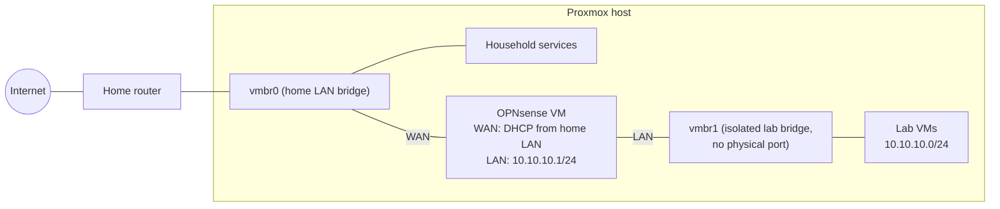

# Homelab: an isolated security lab on Proxmox

A single-node Proxmox server that runs my household services and, kept strictly separate from them, a lab for learning IT and security hands-on: networking, Active Directory, logging and detection, and attack/defend practice. Each stage is documented as a write-up, and the goal is to eventually rebuild the whole lab from code.

I'm documenting this as I go, including the mistakes, because the fixes taught me more than the clean runs did.

## Hardware

| | |
|---|---|
| Host | One Proxmox VE node |
| CPU | AMD Ryzen 7 5700G (8 cores / 16 threads) |
| RAM | 32 GB |
| GPU | None (not needed for anything here) |
| Storage | Boot/VM disk, plus a mirrored pair of drives passed through to a NAS VM |

Existing household services (DNS filtering, VPN, password manager, NAS and media) run on the normal home network, outside the lab.

## Architecture

The lab lives on its own virtual bridge with no physical uplink. The only way in or out is a firewall VM, which blocks lab traffic to the home network while still allowing internet access.



Design principles:

- **Isolation first.** Anything vulnerable or hostile stays on `vmbr1`, behind a firewall I control.
- **Backups before changes.** Every guest is backed up to separate storage, and I've tested restores.
- **Documented and reproducible.** Write-ups now, infrastructure-as-code later.

## Write-ups

| # | Title | Status |
|---|---|---|
| 00 | Host maintenance and backups | Planned |
| [01](writeups/01-isolated-lab-network/README.md) | Isolated lab network with OPNsense | Draft |
| 02 | Active Directory domain | Planned |
| 03 | Central logging and detections (Wazuh, Sysmon) | Planned |
| 04 | Attack and detect: AD attacks seen in the SIEM | Planned |
| 05 | Rebuilding the lab with Terraform and Ansible | Planned |

## Repo layout

```
.
├── README.md
├── writeups/        one folder per write-up, each with its own README and images
├── configs/         scrubbed configuration and detection rules
└── automation/      Terraform / Ansible (later)
```

## A note on what's published

Configs and screenshots here are scrubbed: no real home addresses, credentials, keys, or exported firewall configs. Addresses shown are lab-internal.
